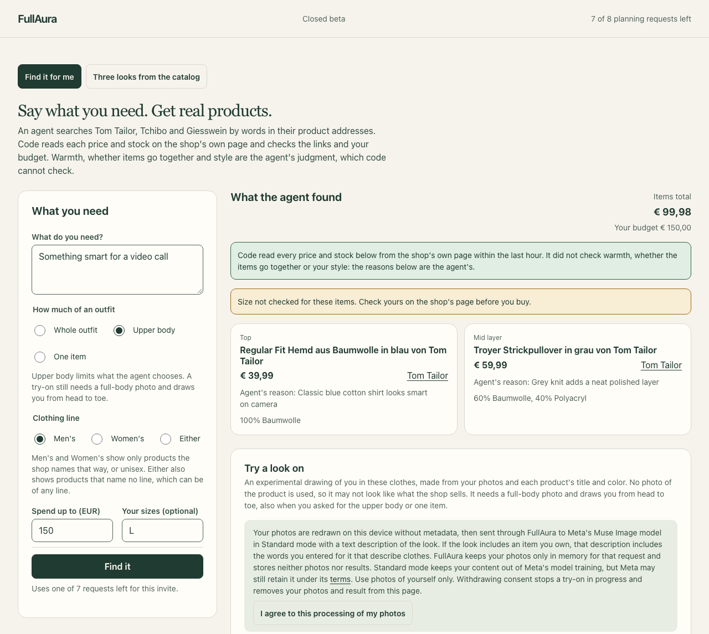
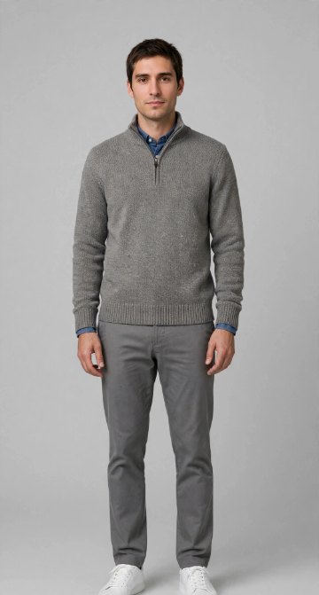
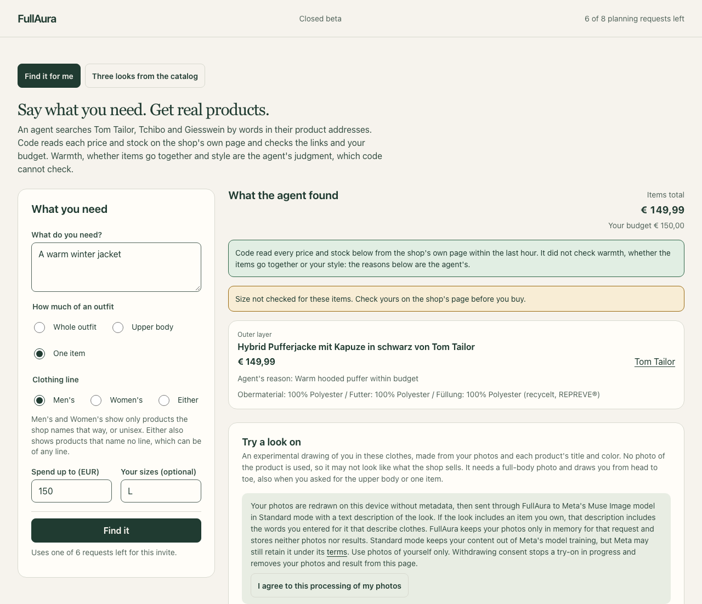

# A recorded run of FullAura

**Recorded run, 2 November 2026. No live model calls.**

This page shows what the deployed site answered to two real requests, so that you can see the product without an invite. Nothing here runs: it is a record of that day, and [Try it live](#try-it-live) says how to run FullAura. The person in the try-on is a synthetic persona generated with Muse Image. Prices and stock are the shops' on that day and may have changed since.

## Something smart for a video call

The request asks for the upper body, in the men's line, for at most €150, in size L. The search took 21 seconds, and the page showed these steps while it ran:

```text
 0.2 s  Opening the shops' product lists
 3.3 s  Looking in the shops for: hemd
 5.3 s  Read the shops' pages: 7 on sale within your budget
 5.3 s  Looking in the shops for: pullover
 7.5 s  Read the shops' pages: 12 on sale within your budget
 7.5 s  Looking in the shops for: strick
 8.1 s  Looking in the shops for: jacke
20.4 s  Checking the choice against what the shops' pages say
```

The agent chose two products, for a total of €99.98. Both prices also appeared on the shop's own pages, opened in a browser that day.

| Position | Product | Price | The agent's reason | Material on the shop's page |
| --- | --- | --- | --- | --- |
| Top | [Regular Fit Hemd aus Baumwolle in blau](https://www.tom-tailor.at/de/p/regular-fit-hemd-aus-baumwolle-maenner-1052333_40704), Tom Tailor | €39.99 | Classic blue cotton shirt looks smart on camera | 100% Baumwolle |
| Mid layer | [Troyer Strickpullover in grau](https://www.tom-tailor.at/de/p/troyer-strickpullover-maenner-1051991_31004), Tom Tailor | €59.99 | Grey knit adds a neat polished layer | 60% Baumwolle, 40% Polyacryl |

Above the products, the page said what code checked and what it did not:

> Code read every price and stock below from the shop's own page within the last hour. It did not check warmth, whether the items go together or your style: the reasons below are the agent's.

> Size not checked for these items. Check yours on the shop's page before you buy.



### The try-on

Muse Image drew the synthetic person in these clothes from a portrait, a full-body photo and text that the server wrote from each shop's title and color. It took 11 seconds. The model receives no photo of the product, and the page says what this drawing is:

> Experimental visualization. Colors, shapes and combinations are approximate: it does not show the exact products, their fit or your size.

Clothes that were not asked for, here the trousers and shoes, stay as in the photo.



## A warm winter jacket

This request asks for one item, in the men's line, for at most €150, in size L. The search took 15 seconds:

```text
 0.4 s  Opening the shops' product lists
 2.5 s  Looking in the shops for: jacke
 2.5 s  Read the shops' pages: 12 on sale within your budget
15.1 s  Checking the choice against what the shops' pages say
```

The agent chose the [Hybrid Pufferjacke mit Kapuze in schwarz](https://www.tom-tailor.at/de/p/hybrid-pufferjacke-mit-kapuze-maenner-1052359_29999) from Tom Tailor at €149.99, with the reason "Warm hooded puffer within budget". Code does not check warmth. The shop's own page said "warm gefüttert" (warm-lined) that day.



## What a recording does not show

A recording does not show that the models or the shops answer today. A new search can return other products, and a search can fail: of twelve real searches on this code on 2 November, eleven succeeded, and one failed because the model's provider answered with status 503 twice. The site's second mode, three looks from a small catalog, is not part of this record.

## Try it live

The [deployed site](https://fullaura-demo.blackbay-aaeee2c5.francecentral.azurecontainerapps.io) is a closed beta that needs an invite, because each search and try-on is a paid model call.

You can also run FullAura with your own keys, as [Run locally](../README.md#run-locally) in the README describes. The shopping agent and the try-on need `MODEL_API_KEY` for Meta's API, and the catalog mode needs `BASETEN_API_KEY`. The calls are charged to those keys.
